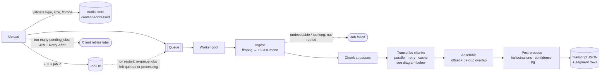
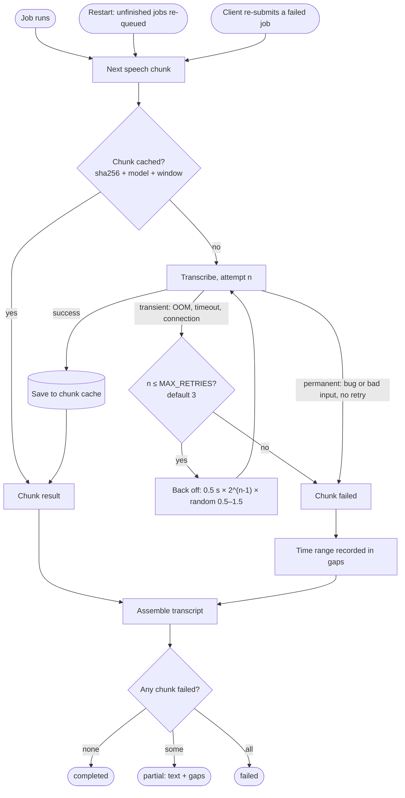

# Audio Decoder

A speech-to-text pipeline. It accepts an audio file (WAV, MP3, M4A, FLAC, OGG and more), transcribes it with
[faster-whisper](https://github.com/SYSTRAN/faster-whisper) (an open-source Whisper implementation), and returns
the transcript with **timestamps per segment**. The text is then cleaned for downstream use: likely
hallucinations are removed, low-confidence segments are flagged, and PII is redacted. Results are available as
JSON, SRT subtitles, plain text, or JSONL rows for a warehouse or search index.

It runs as a **REST API** (asynchronous jobs) or as a **CLI** for single files.

The focus is on the engineering around the model rather than the model itself. The model is a swappable
component behind a small interface.

---

## Quick start

Requirements: Python 3.10+ and **ffmpeg** on `PATH`
(Windows: `winget install Gyan.FFmpeg`; macOS: `brew install ffmpeg`; Debian/Ubuntu: `apt install ffmpeg`).

```powershell
python -m venv .venv
.venv\Scripts\activate            # Linux/macOS: source .venv/bin/activate
pip install -e ".[dev]"
```

### Transcribe a file (CLI)

```powershell
audio-decoder transcribe path\to\call.mp3 --out output --formats json,srt,txt
```
The first run downloads the Whisper model (`small` by default, about 460 MB).
Use `--model tiny` for a quick try or `--model large-v3` for the best accuracy.

### Run the API

```powershell
audio-decoder serve --port 8000          # or: uvicorn audio_decoder.api:app --port 8000
```
Interactive docs: http://localhost:8000/docs

```bash
# 1. upload -> 202 Accepted + job id
curl -F "file=@call.mp3" -F "language=en" http://localhost:8000/v1/transcriptions

# 2. poll status (result is embedded once finished)
curl http://localhost:8000/v1/transcriptions/<job_id>

# 3. download in another format
curl "http://localhost:8000/v1/transcriptions/<job_id>/result?format=srt"
```

### Try it offline with mock data (no model download)

```powershell
python scripts\make_demo_audio.py                      # writes samples\demo_call.wav + script
audio-decoder transcribe samples\demo_call.wav --mock-script samples\demo_call.script.json --out output
```
The demo is a synthetic three-minute insurance claim call. It is designed to exercise every path: pauses, a
55-second stretch with no pause (forced cut), a 50-second hold (skipped as silence), a hallucination on silence,
a repetition loop, a low-confidence line, and PII. The outputs it produces are committed in
[`examples/`](examples/).

### Docker

```bash
docker build -t audio-decoder --build-arg WHISPER_MODEL=small .
docker run -p 8000:8000 -v audio-data:/data audio-decoder
```

### Tests

```bash
pytest -q        # 40 tests, run offline with the mock backend
```

---

## API

| Method | Path | Description |
|---|---|---|
| `POST` | `/v1/transcriptions` | Multipart `file` (+ optional `language`). Returns **202** with a new job, or **200** with the existing job if the same audio was already submitted. |
| `GET` | `/v1/transcriptions/{id}` | Job status (`queued`, `processing`, `completed`, `partial`, `failed`); includes the result once finished. |
| `GET` | `/v1/transcriptions/{id}/result?format=json\|txt\|srt\|jsonl` | Rendered result. **409** if not finished yet. |
| `GET` | `/health` | Liveness. |

Errors: `400` empty file · `401` bad/missing `X-API-Key` (when `AUDIO_DECODER_API_KEY` is set) · `404` unknown
job · `413` too large · `415` unsupported type · `422` not decodable or too long · `429` too many pending jobs
(retry after the `Retry-After` header).

### Output (abridged)

```json
{
  "schema_version": "1.0",
  "status": "completed",
  "source": { "filename": "call.mp3", "sha256": "…", "duration_s": 191.66, "original_format": "mp3" },
  "backend": { "name": "faster-whisper", "fingerprint": "faster-whisper:small:int8:beam5" },
  "language": "en",
  "redacted": true,
  "text": "Good afternoon, thank you for calling …",
  "segments": [
    { "id": 7, "start": 35.131, "end": 39.362,
      "text": "It's [EMAIL], and my phone number is [PHONE].",
      "chunk_index": 1, "avg_logprob": -0.25, "no_speech_prob": 0.02,
      "flags": ["redacted_email", "redacted_phone"] },
    { "id": 16, "start": 154.354, "end": 158.2,
      "text": "uh it was the uh other driver's fault I think", "flags": ["low_confidence"] }
  ],
  "gaps": [],
  "chunks": [ { "index": 2, "start": 60.43, "end": 90.43, "cut": "silence", "status": "skipped_silence" } ],
  "stats": { "words": 304, "words_per_minute": 95.2, "low_confidence_segments": 1, "real_time_factor": 0.0002 }
}
```
The full example is in [`examples/demo_call.json`](examples/demo_call.json).

---

## Architecture



### Retry and recovery

Failures are handled per chunk (~30 s of audio), so one bad chunk costs one chunk, not the file.



Because every finished chunk is cached, a restart or a re-submission only redoes the chunks that are missing.
Retry count and base delay are set by `AUDIO_DECODER_MAX_RETRIES` and `AUDIO_DECODER_RETRY_BASE_S`.

```
src/audio_decoder/
  api.py          REST endpoints; upload streaming and validation
  jobs.py         async job manager, worker pool, crash recovery, idempotency
  ingest.py       ffprobe validation, ffmpeg decode, SHA-256 fingerprint
  chunking.py     pause-aware chunk planning with owned time ranges
  pipeline.py     per-chunk retry and cache, language pinning, assembly, result building
  postprocess.py  text cleanup, hallucination filter, confidence flags, PII redaction
  exporters.py    json / srt / txt / jsonl
  storage.py      blob store (local FS) + job/segment repository (SQLite)
  backends/       Protocol + faster-whisper + deterministic mock
  cli.py, config.py
scripts/make_demo_audio.py   mock data generator
tests/                       unit, pipeline and API tests
```

---

## Design decisions

### 1. Model: faster-whisper, behind an interface
- **Why Whisper:** it is open source, handles many languages, copes well with accents and noise, and needs no
  training. **Why faster-whisper over `openai-whisper`:** it is roughly 4× faster on CPU with int8
  quantisation, uses less memory, and gives **word timestamps**, which the overlap de-duplication relies on.
- The pipeline depends only on `TranscriptionBackend` (`fingerprint()` and `transcribe(chunk, language)`).
  Swapping to Azure Speech, Deepgram or a GPU server is a new class, not a rewrite. The **mock backend**
  makes the whole system testable offline and deterministic.
- `condition_on_previous_text=False`: slightly less context, but it removes Whisper's best-known failure mode,
  repetition loops that carry on across windows.

### 2. Audio formats: one canonical representation
Everything is decoded by **ffmpeg** to **16 kHz mono 16-bit PCM**, which is exactly what Whisper expects.
Different sample rates and stereo are therefore handled in one place, and nothing after ingest knows what the
input format was.
- Validation happens **by content (`ffprobe`), not just by extension**, at upload time, so clients get a 415 or
  422 immediately rather than a failed job later.
- A **maximum duration** is enforced as well as a maximum size: a small, highly compressed file can still
  decode into hours of audio.
- Samples are kept as int16 (half the memory of float32) and converted per chunk.

### 3. Long audio: pause-aware chunking with owned ranges
Whisper works on 30-second windows. Rather than hand a two-hour file to the model in one call, the pipeline
plans its own chunks:
- **Cuts at pauses** near a 30-second target (between 10 and 45 seconds), so words aren't split in half. A
  long pause can be cut anywhere inside it, so a long hold or dead air becomes a **silent chunk that is skipped**:
  it costs nothing and gives Whisper no silence to hallucinate on.
- If there is no pause within 45 seconds, it makes a **hard cut with a 2-second overlap**.
- Each chunk **owns** a half-open range `[own_start, own_end)`. The owned ranges partition the timeline, and a
  word is kept only if its **midpoint** falls in its chunk's owned range. Every word is therefore kept
  **exactly once**, with no duplicates or losses at the overlap. A test checks this against the full demo
  script. Sentences split by a hard cut are joined back together.
- Chunking gives **parallelism** (chunks run concurrently), **recoverability** (a failure costs one chunk), and
  bounded memory and latency per unit of work.
- **Language pinning:** the language is detected on the first speech chunk and passed to all the others, so
  chunks don't each detect it separately and come out inconsistent.

### 4. Timestamps
Backends return timestamps relative to the chunk. Assembly adds the chunk's offset, so all output is in
absolute seconds from the start of the file. Segment boundaries are taken from the first and last kept word,
so they stay accurate after de-duplication.

### 5. Concurrency: async jobs, bounded workers
- The API **never transcribes inside the request.** Upload → store → enqueue → **202 + job id**. Long files
  don't hit HTTP timeouts, and the event loop stays responsive (blocking work runs in threads).
- Two levels of concurrency, both configurable and bounded: `WORKERS` (jobs at a time) and `CHUNK_WORKERS`
  (chunks per job). Load spikes **queue up** instead of exhausting the CPU, GPU or RAM. Each running job
  holds its decoded audio in memory (~115 MB per audio hour), so size `WORKERS` to RAM as well as cores.
- **Back-pressure:** once `MAX_PENDING_JOBS` are queued or processing, new uploads get **429 + `Retry-After`**
  (re-submitting audio that already has a job still returns that job). This also bounds disk used by pending
  uploads. Queued jobs report a `queue_position`.
- **Race-safe submission:** the dedup check and job creation happen under one lock, so identical concurrent
  uploads produce one job. Stored audio is never overwritten (safe while a worker has it open, which matters
  on Windows), and cache/transcript writes use a temp file unique to each writer before an atomic rename.
- One model instance per process, loaded lazily under a lock and shared by all workers; CTranslate2's
  `num_workers` lets it serve parallel calls.
- Uploads are **streamed to disk in 1 MB pieces** while being hashed, so memory stays flat regardless of file
  size.

### 6. Failure handling and recovery
- **Transient vs permanent:** timeouts, OOM and runtime errors are retried with **exponential backoff and
  jitter** (default three retries). Bad input and programming errors **fail fast**, because retrying cannot
  fix them.
- **Chunk-level cache** keyed by `audio sha256 + model fingerprint + chunk window`: re-running a job only
  redoes the chunks that failed, and a model upgrade automatically invalidates the cache.
- **Partial results instead of all-or-nothing:** if some chunks still fail, the job is `partial` and lists
  `gaps` (time ranges with no coverage), so downstream systems never confuse missing audio with silence.
- **Crash recovery:** on startup, jobs left `queued` or `processing` are re-queued and resume from the cache.
- Writes are **atomic** (temp file + rename), so readers never see a half-written transcript.

### 7. Idempotency
Audio is stored by **content hash**. Uploading the same file with the same language returns the existing job
(200) instead of transcribing it again. A `partial` or `failed` job is not reused, so re-submitting triggers a
resume.

### 8. Post-processing for downstream use
- **Cleanup:** whitespace and punctuation spacing.
- **Hallucination filter:** known phrases Whisper produces on silence ("Thank you for watching.") when
  `no_speech_prob` is high, segments with very high `no_speech_prob` and low `avg_logprob`, and low-confidence
  repeats of the previous segment.
- **Confidence flags rather than silent deletion:** segments with `avg_logprob < -1.0` or
  `no_speech_prob > 0.6` are kept but flagged `low_confidence`, so a QA queue or analyst can review them.
- **PII redaction (on by default):** emails, phone numbers, and card numbers (**Luhn-validated**, so ordinary
  digit strings aren't redacted). Business identifiers such as policy and claim numbers are kept because
  downstream joins need them. Redaction happens before anything is stored or indexed.

### 9. Storage and output contract
| What | Local implementation | Production equivalent |
|---|---|---|
| Original audio | `data/audio/<sha256>.<ext>` | Azure Blob / S3 with lifecycle (hot → cool → archive → delete) |
| Full transcript | `data/transcripts/<job_id>.json` | Blob, immutable, versioned |
| Jobs + segments | SQLite (`jobs`, `segments` tables) | SQL Server / Postgres |
| Chunk cache | `data/cache/…` | Blob or Redis |

The JSON result is **schema-versioned** and records the **model fingerprint**, so transcripts produced by
different models are distinguishable and re-processing is traceable. The **JSONL** export gives one row per
segment for warehouse or search bulk loads; **SRT** is for subtitle players.

### 10. Configuration and operations
All settings are environment variables (`AUDIO_DECODER_*`, see [`.env.example`](.env.example)), which suits
containers. Optional API-key auth. Per-chunk timings, attempts and a **real-time factor**
(processing time ÷ audio duration) are included in every result for capacity planning. Structured logs go to
stdout.

---

## Moving to production

The local components were chosen so each one maps directly to a managed service:

- **Queue:** replace the in-process `queue.Queue` in `JobManager` with Azure Service Bus or SQS (with
  dead-lettering after N deliveries), and run workers as a separate GPU deployment autoscaled on queue depth.
- **Storage:** implement `BlobStore` on Azure Blob and `JobRepository` on SQL Server; upload directly to Blob
  via SAS URLs for very large files.
- **API:** add webhooks for job completion, per-client rate limits, OAuth, and OpenTelemetry tracing.
- **Accuracy:** speaker diarization (e.g. pyannote), domain vocabulary via Whisper's `initial_prompt`, inverse
  text normalisation for spoken numbers, and NER-based PII detection alongside the regexes.

## Known limitations

- The full decoded file is held in memory as int16 (about 115 MB per hour of audio). Very long files should be
  decoded in pieces.
- The in-process queue is lost if the process dies mid-job; jobs are re-queued from the DB on restart, but
  multi-instance deployments need an external queue.
- Silence detection is energy-based; in very noisy recordings a model-based VAD (Silero) would choose cuts
  better.
- Regex PII detection covers common formats only.
- The test suite uses the mock backend; the faster-whisper backend needs the model download to run.
